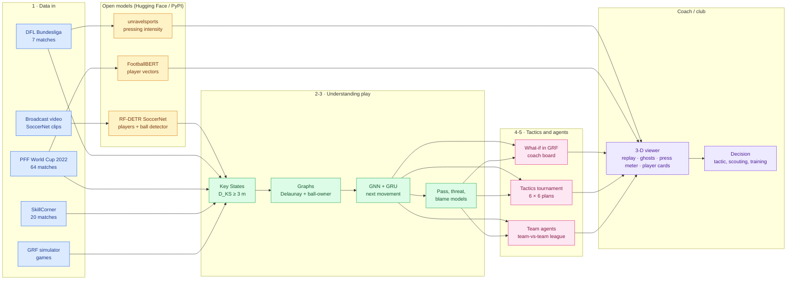
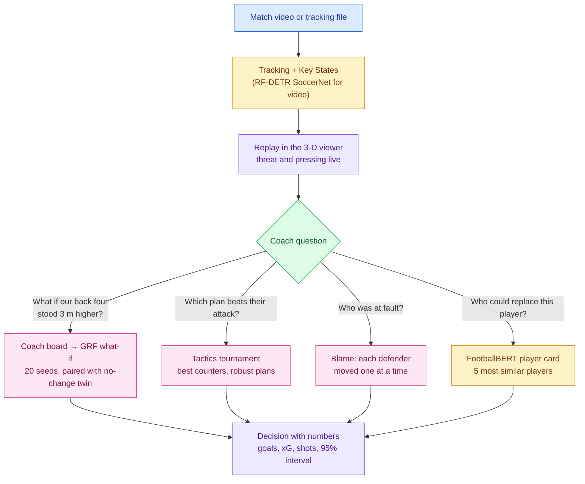

# Dynamic Tactical AI for football

A five-layer tactics AI built on real football tracking data (DFL / Sportec, PFF World Cup 2022, SkillCorner) and the
Google Research Football (GRF) simulator, with a 3-D web viewer where a coach can replay a match, move players and ask "what if?".
MSc Data Engineering & AI, DVRC / ESILV. Supervisor: Prof. Ahmed Azough. Developer: Srinivasan.

## The whole system at a glance



## How a club uses it



## Status

| Layer | What | Status |
|---|---|---|
| 1 Data | DFL (7), PFF World Cup 2022 (64), SkillCorner (20), GRF games, broadcast video; one format (105 x 68 m) | done |
| 2 Key States | frames where play moved by at least 3 m, sequences and their types | done |
| 3 Graphs | Delaunay / radius graphs, ball-owner pass graph, GNN + GRU over Key States | done |
| 4 Tactics | what-if in GRF, coach board, blame, tactics tournament (6 x 6 plans, 6,048 runs), what-if emulator | done |
| 5 Agents | team models playing full GRF matches, team-vs-team league; TiZero (open agent) as strong player / defender | first version (our models lose to GRF's AI; TiZero beats it, +1.55 goals) |
| App | 3-D viewer: replay, what-if ghosts, coach board, threat, pressing meter, player cards, video to board | done |

## Key results

| Quantity | Result | Baseline |
|---|---|---|
| Player movement error on an unseen match (DFL) | 1.11-1.14 m | 1.51 m (keep velocity) |
| Ball movement error | 3.29 m | 6.19 m |
| Real receiver ranked first by the BO graph | 45% | 10% chance, 27% nearest teammate |
| Will the pass arrive (AUC) | 0.84 | 0.62 (pass length only) |
| What-if: early pass 2.6 s before a goal (20 seeds) | +0.40 ± 0.26 goals | no change |
| Team style in movement (PFF, SkillCorner) | -0.002 m, not detectable | pooled model |
| Simulator gap to real football (realism scorecard) | 64-68% | 0% = real |

## Open models we use

Pinned in `hf_models.json` (repo, exact revision, sha256, licence); `scripts/hf_models.py list | verify | fetch <name>`.

| Model | Source | Where it is used | Result |
|---|---|---|---|
| RF-DETR SoccerNet | Hugging Face `julianzu9612/RFDETR-Soccernet` | `track_eval.py --detector rfdetr_sn`, `export_video_board.py` (video → 3-D board) | player coverage 0.85-0.92 → 0.93-0.95; ball now tracked (34-78% of frames); ID switches still high on one clip |
| FootballBERT | Hugging Face `achadj/footballbert-base` | `export_fbert.py`: player cards (690 World Cup players, 5 most similar); `train_gnn.py --player-emb` | scouting: Messi → Suárez, Griezmann, Di María, Dybala, Cavani. Movement GNN: no gain (0.95 m without, 0.97 m with, shuffled 0.99 m, 3 held-out matches) |
| unravelsports Pressing Intensity | PyPI `unravelsports==1.2.1` (BSD-3) | `unravel_trial.py`, `pressing_from_csv.py`, live in the viewer (`viewer/press.js`) | 7 DFL matches: high middle-third pressing → 2.1 pp fewer opponent shots (± 0.4); CSV port matches the package (r = 0.997) |
| TiZero | Hugging Face `OpenRL/tizero` (Apache-2.0) | `tizero_eval.py`, `tizero_whatif.py`, `whatif.py --defender tizero` | vs GRF hard built-in AI (20 full games): won 75%, goals 2.70 - 1.15, GD +1.55 ± 0.70 (our team agents: about -9). As the defence in what-if, our attack scores 0 in 140 runs: earlier what-if gains (early pass +0.40) only hold against a weak defence |
| offscreen-impute (centroid voting) | GitHub `nowayfootball/offscreen-impute` (MIT) | `impute_offscreen.py`, `export_video_board.py --fill` (off-camera players as ghosts) | DFL 7 matches, simulated 44 m camera (15 of 22 visible): hidden players 9.1 m median (last seen 15.9 m); team pitch-control share error 11.2 → 3.9 points; video boards 3-12 → 16-20 players |
| Our learned filler (on top of centroid voting) | own model, UniTraj-style masking | `impute_offscreen.py learn` | hidden players **3.3 m** median (held-out matches): 1.0 m if hidden < 2 s, 3.5 m for 2-9.6 s, 6.1 m beyond |

## The viewer

```bash
python -m http.server 8765 --directory viewer        # then open http://localhost:8765
```

Real match and what-if runs side by side or as ghosts, five cameras, coach board (drag players, then play the board in GRF),
threat pill, pressing pill and timeline (red = home pressing, blue = away), FootballBERT player card on click,
and "Video to board" files made from broadcast clips. Data files in `viewer/data/` (`index.json` lists them).


## Folder map

```
settings.json         the one place for every number and every match list
scripts/              all code (about 100 Python files), run from the project root
viewer/               3-D web app (Three.js): app.js, press.js, threat.js, data/
hf_models.json        pinned open models (Hugging Face / PyPI)
data/                 NOT in the repository (about 1.7 GB), rebuilt by scripts/run_pipeline.py
  real/raw/             downloaded DFL files (tracking, events, players, meta)
  real/processed/       common-format CSV and every derived file per match
  simulated/            GRF games in four settings (stochastic, easy, hard, competition)
outputs/              figures, tables, model weights and the run log (outputs/run_log.csv)
docs/                 presentations
grf-setup/            Docker / setup notes for the GRF environment
```

## Scripts, in the order the data flows

| Stage | Scripts | Main outputs |
|---|---|---|
| Data | `download_real.py`, `save_meta.py`, `convert_real.py`, `register_matches.py`, `export_tracking.py`, `run_pipeline.py` | `data/real/processed/<match>.csv.gz`, `data/real/matches.csv` |
| Key States | `extract_keystates.py`, `find_sequences.py`, `describe_sequences.py`, `cluster_sequences.py` | `<match>_adaptive_ks.csv`, `_sequences.csv`, `_sequence_types.csv` |
| Graphs and network | `build_graphs.py`, `train_gnn.py`, `run_folds.py`, `compare_archs.py`, `run_gat_plus.py` | `<match>_graphs.npz`, `outputs/gnn_model*.pt`, `outputs/compare_archs.csv` |
| Ball-owner graph | `bo_graph.py`, `extract_passes.py`, `receiver_check.py`, `fit_bo_weights.py`, `plot_bo_graph.py` | `<match>_passes.npz`, `outputs/bo_params_learned.json`, `outputs/receiver_check.csv` |
| Pass models | `pass_features.py`, `fit_pass_model.py`, `build_pass_edges.py`, `decision_quality.py`, `validate_gain.py`, `speed_check.py` | `<match>_passfeat.npz`, `<match>_passedges.npz`, `outputs/pass_model.json` |
| Evidence | `scoreboard.py`, `realism_scorecard.py`, `run_pass_proof.py`, `prove_pass_edges.py` | `outputs/scoreboard.csv`, `outputs/realism_scorecard.csv`, `outputs/prove_pass_edges.csv` |
| Tactics | `tactical_states.py`, `tactics_profile.py` | `outputs/tactics_*.csv` |
| GRF replay and what-if | `grf_follow.py`, `grf_pass.py`, `grf_goal.py`, `whatif.py`, `coach_board.py`, `blame*.py` | `outputs/whatif/`, `outputs/coach_board/` |
| Tactics tournament | `tactics_tournament.py` | `outputs/tournament_v2/` (payoff, best counters, robust plans) |
| Team agents | `team_policy.py`, `team_decisions.py`, `team_agent.py`, `team_league.py` | `outputs/team_league/` |
| Vision (video) | `vision_poc.py`, `track_eval.py`, `export_video_board.py` | `outputs/vision/tracks_sn/`, `viewer/data/video_*.json` |
| Open models | `hf_models.py`, `unravel_trial.py`, `pressing_from_csv.py`, `footballbert_trial.py`, `export_fbert.py` | `outputs/unravel/`, `outputs/footballbert/`, `viewer/data/player_cards.json` |
| Viewer | `export_viewer.py`, `viewer/` | `viewer/data/*.json` |

## Reproduce

```bash
python -m venv .venv-analysis
.venv-analysis\Scripts\pip install -r requirements-analysis.txt      # Windows; use bin/ on Linux
.venv-analysis\Scripts\python scripts\run_pipeline.py                # downloads and converts the real matches, builds Key States and graphs
.venv-analysis\Scripts\python scripts\run_folds.py                   # leave-one-match-out network training
.venv-analysis\Scripts\python scripts\extract_passes.py
.venv-analysis\Scripts\python scripts\pass_features.py
.venv-analysis\Scripts\python scripts\fit_pass_model.py
.venv-analysis\Scripts\python scripts\scoreboard.py
```

The simulated games need the GRF environment (Python 3.10, see `grf-setup/README.md` and `requirements-grf.txt`).

## Data

The real match data is the DFL / Sportec open dataset (IDSSE). It is not redistributed here: `scripts/download_real.py` fetches it
under the dataset's own licence. Simulated games come from Google Research Football.
